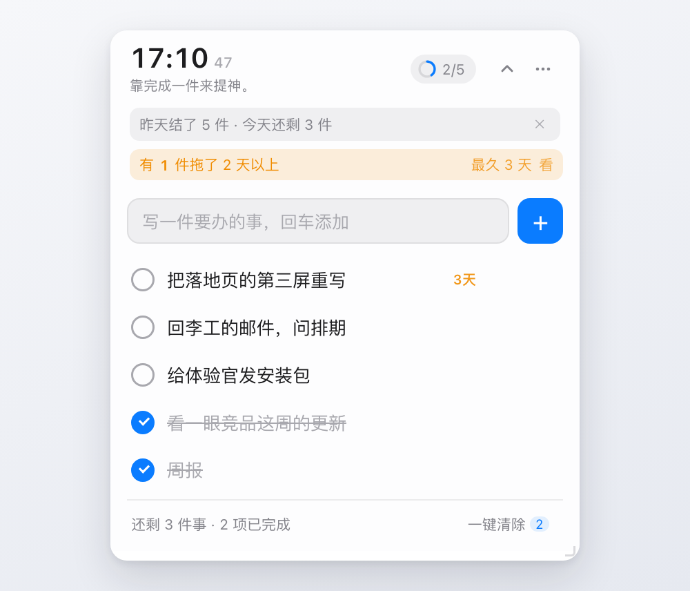
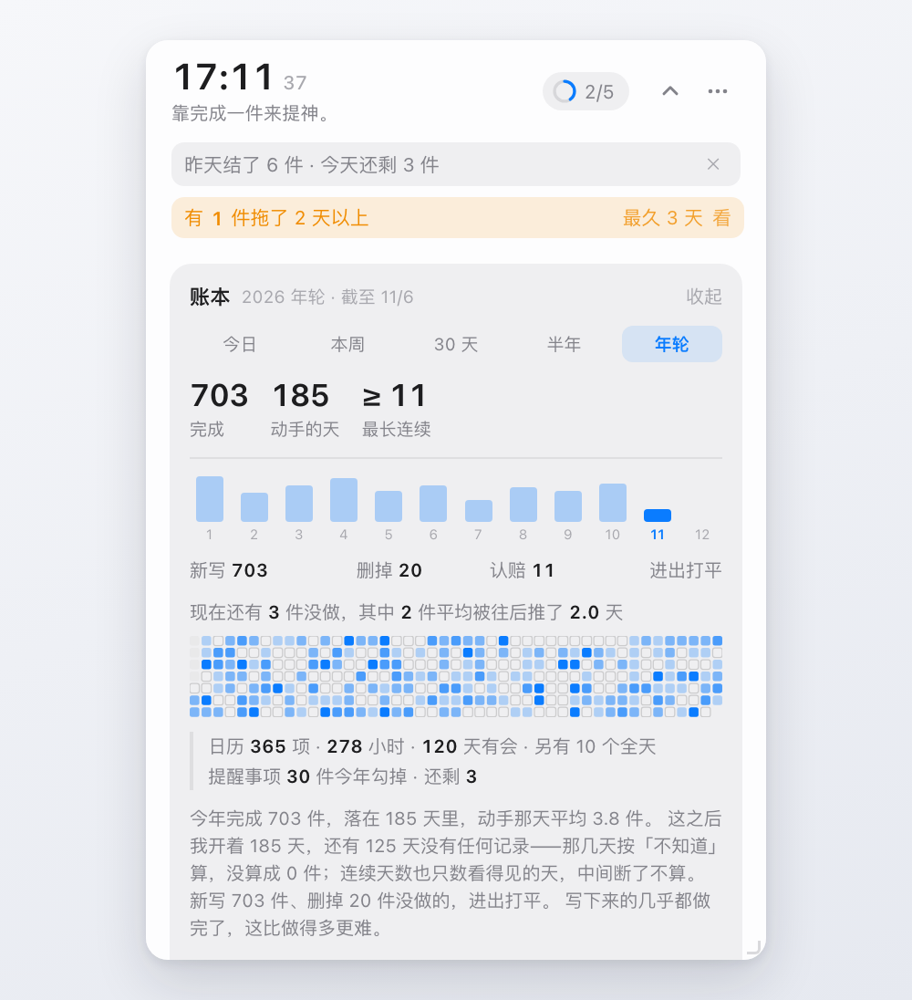

# 浮窗待办（DeskTodo）

**一个贴在桌面上的待办浮窗。macOS，原生，零依赖，数据只在你硬盘上。**

[](https://github.com/wesley9311/desktodo/actions/workflows/ci.yml)
`0.5.0` · MIT · macOS 12+ · 1.2 MB · 195 条断言



它只做一件事：让你在干活的时候抬眼就能看见"今天还剩几件"，干完勾掉，
年底能翻回来看这一年到底做了多少、哪天在做、哪天没有。

**说到底是本日账本，不是任务管理器**：待办软件问你"还有什么没做"，它问你"欠了自己多少"。
不排项目，不协作，不同步。

## 一天一页，四个动作

| | 做什么 | 在哪看得见 |
|---|---|---|
| **记** | 随手写一条，回车进清单；过夜的自动接到今天 | 输入框 |
| **划** | 干完勾掉，记下是几点勾的；勾错了能退账 | 清单 + 顶上的 `2/5` |
| **结** | 每天第一次打开，结一句「昨天结了 N 件」；拖过 2 天的进欠账面板，可以放回今天，也可以销账 | 顶部的灰条与橙条 |
| **稽** | 今日 / 本周 / 30 天 / 半年 / 年轮 | 报告卡五个页签 |

## 装

**[⬇ 下载最新版](https://github.com/wesley9311/desktodo/releases/latest)** · 不用装 Xcode

1. 解压，得到一个文件夹，里面有 `安装.command` 和 `浮窗待办.app`
2. **右键**点 `安装.command` → 选「打开」→ 弹窗里再点一次「打开」
3. 完事。它没有 Dock 图标，看右上角菜单栏 / 桌面右下角的小圆点

> 直接双击会被系统拦住，弹窗里只有「移到废纸篓」和「取消」——看到那个点「取消」，
> 然后照第 2 步右键打开。**只有这一次。**

**升级**也是同一套动作（下载新包 → 右键 `安装.command`）。升级后日历 / 提醒事项 /
完全磁盘访问要**重新授权一次**：这个包没做 Apple 公证，每版签名都不同，系统会把它
当成另一个程序，把授权收回去。记录不会丢——数据不在 app 里面。
>
> 原因：没做 Apple 公证（要付费开发者账号），Gatekeeper 对来路不明的程序一律先拦。
> 安装脚本跑起来之后会自动去掉隔离标记，之后双击就正常了。手动绕过：
>
> ```bash
> xattr -dr com.apple.quarantine /Applications/浮窗待办.app
> ```

装上是**零数据**：没有示例任务，没有我的记录，第一次打开就是空的。

**从源码**（需要 Xcode 命令行工具）：

```bash
git clone https://github.com/wesley9311/desktodo.git
cd desktodo
./build.sh          # 编译 + 打包 + 签名 + 安装到 ~/Applications
```

第一次运行会问日历和提醒事项的权限，**都是只读**。不给也能用，只是少那两行对照。

## 三条承诺，都能当场验证

这个项目的前提是：**关于隐私的承诺如果不能被验证，就只是广告。**

| 承诺 | 怎么验 |
|---|---|
| 不联网也能用 | 菜单 →「不联网（天气停更）」，然后 `lsof -nP -a -p $(pgrep -f DeskTodo) -i` —— **没有任何输出** |
| 数据是普通文件 | `open ~/Library/Application\ Support/DeskTodo/data.json` —— 明文 JSON，字段名是人话 |
| 删了就是没了 | 菜单 →「清空全部数据…」—— 主文件、备份、留证文件全删，不进废纸篓 |

第四条是给以后的：**三年后这个 app 打不开了，数据还活着吗？**
菜单 →「导出全部数据…」给你一个 zip：`data.json` 原件 + 一份 `读我.md`，
里面带着格式版本、逐年数字、字段表和口径声明。换任何工具都能读。

## 一份账，年底能翻回来看



四条口径，跟主流待办 app 不一样，理由都在 [docs/PRODUCT-BOUNDARY.md](docs/PRODUCT-BOUNDARY.md)：

- **没记录 ≠ 0 件**。空白的一天不会被画成"那天你什么都没干"。
  热力图、月柱、连续天数、日均，全部先过同一个口径函数。
- **历史不回改**。今天的口径变了，去年的数字不跟着变。一旦用户发现记的东西会变，
  他就不会再记了。
- **节日只认系统日历**。放假日年年在变，内置一张表，第二年就是编的。
- **不做连续天数激励**。它会诱导用户为了不断连而补记，等于制造假数据。

## 只有 macOS

不是时间不够，是三块数据在 Windows / Linux 上根本没有对应物：

| 用到什么 | macOS | 其他系统 |
|---|---|---|
| 屏幕使用时间 | 读系统 `knowledgeC.db`（只读 SQLite） | 没有可读的同类库 |
| 日历 / 提醒事项 | EventKit，本地读，**离线** | 只能走 Graph API（**联网 + 账号**），与本项目的边界直接冲突 |
| 空闲 / 锁屏 | `CGEventSource` | 有等价 API（`GetLastInputInfo`），能做 |

一句话：**记账那部分（记 / 划 / 结 / 稽）能跨平台，数据源那部分不能。**

为了凑平台做一个缺了日历和屏幕时间的半成品，那是把产品当成功能清单。
哪天做 Windows，判断依据只有一个：有 Windows 用户明确说出他要的是哪一件。

## 它不做什么

不是"暂时没做"，是不会做。完整清单和理由在 [CONTRIBUTING.md](CONTRIBUTING.md)：

不做账号、不做云同步、不做埋点、不做崩溃上报、不调任何模型、
不内置节日表、不采窗口标题、不做排行榜、不做番茄钟、不替你补记。

这份"不可加清单"不是姿态。它被写成了 CI 里的检查（`tools/audit.sh` 八类）：
谁加一行 `URLSession`，或者往 `Info.plist` 里多要一个权限，构建直接失败。

## 它读你什么

只有日历和提醒事项，**只读**，用途写在系统弹窗里。
可选的第三项是完全磁盘访问，只为读系统「屏幕使用时间」显示今天用了多久——**不弄也能用**。

唯一的外部连接是天气（`ipwho.is` 定位 + `open-meteo` 取数），不传任何本地数据，
可以一键关掉。细节、威胁模型、以及"它不防什么"，都在 [SECURITY.md](SECURITY.md)。

## 代码结构

```
src/*.swift              原生壳（3654 行 / 15 个文件）：窗口、圆点、菜单、桥、数据源
src/js/01..10-*.js       页面（3956 行 / 10 个分片），按职责分片，构建时拼成单个 IIFE
src/styles.css           样式（926 行）
tools/bundle.sh          分片 → 单文件（WKWebView 用 file://，不能用 ES module）
tools/audit.sh           边界审计八类：网络出口 / 反遥测 / 权限面 / 数据不入库 / 可移植性 / 口径唯一 / 调试入口 / 诊断日志
tools/check.js           195 条行为断言（headless Chrome，21 个用例）
tools/docs-check.sh      文档里的行数/断言数与实测一致（过期就红）
tools/dist.sh            打体验版分发包（ad-hoc 签名，谁都能跑）
```

`build.sh` 用本机固定自签证书签名（重建不掉权限），`tools/dist.sh` 用 ad-hoc 签名
（任何机器都能跑）。两条路互不干扰，原因见 [docs/PRODUCT-BOUNDARY.md](docs/PRODUCT-BOUNDARY.md)。

## 文档

| 你想知道的 | 看这份 | 谁该看 |
|---|---|---|
| 界面上每一处、每个菜单项、每种异常怎么办 | [docs/MANUAL.md](docs/MANUAL.md) | 用它的人 |
| 每一版改了什么、为什么这么改 | [CHANGELOG.md](CHANGELOG.md) | 用它的人 |
| 代码怎么组织、改完怎么验、怎么发版 | [docs/DEVELOPMENT.md](docs/DEVELOPMENT.md) | 改代码的人 |
| 为什么是账本不是清单；新功能的准入标准 | [docs/POSITIONING.md](docs/POSITIONING.md) | 提需求的人 |
| 每一次取舍的决策记录（含被否决的方案） | [docs/PRODUCT-BOUNDARY.md](docs/PRODUCT-BOUNDARY.md) | 提需求的人 |
| 有哪些已知问题、修了没、没修的为什么 | [docs/audits/2026-11-06.md](docs/audits/2026-11-06.md) | 用它的人 |
| 提 PR 必须守什么 | [CONTRIBUTING.md](CONTRIBUTING.md) | 改代码的人 |
| 威胁模型、它不防什么 | [SECURITY.md](SECURITY.md) | 谨慎的人 |

## 支持

- **用它，然后告诉我有哪一天你没打开过、为什么。** 这比任何功能建议都值钱。
- 提 issue：口径算错、文案说错话、状态没交代清楚，这几类最欢迎。
- 说"加个 XX 就好了"的时候，也说说没有它的时候你是怎么过的——不然我听不出是真需求还是顺口一想。

没有赞助入口，也不打算有。这是个 MIT 的小工具，一个人写、一个人维护；
收钱就得对钱负责，那是另一件事。有意见直接说，比什么都有用。

## 许可

代码 MIT，名称与图标保留，见 [LICENSE](LICENSE) 与 [NOTICE.md](NOTICE.md)。
自己改着玩随便；要分发请换名字、换图标、改 bundle id。
